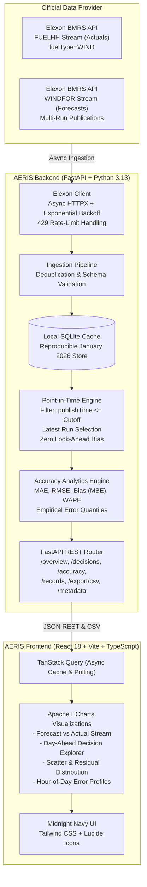

# AERIS — System Architecture & Design Specification

## 1. System Overview

**AERIS — Wind Forecast Intelligence** is a specialized energy-trading decision-support system designed for UK electricity utilities operating in the Day-Ahead wholesale market. 

When purchasing wholesale power on day $D$, utilities face weather-driven volumetric risk: wind production fluctuates, and deviations must be covered through expensive within-day balancing mechanisms or dispatch of flexible thermal generators. AERIS reconstructs the exact state of knowledge available at any historical decision cutoff time on day $D$, evaluates forecast errors against actual outturn generation on day $D+1$, and provides quantitative accuracy metrics and empirical uncertainty bounds to de-risk power procurement.

## 2. Architectural Layers

### 2.1 Data Ingestion & Storage Layer
- **Source**: Elexon BMRS open datasets via HTTPS stream endpoints (`/datasets/FUELHH/stream` and `/datasets/WINDFOR/stream`).
- **Resiliency**: Built on HTTPX with asynchronous streaming, retry with exponential backoff (initial 1.0s, factor 2.0, max 3 retries), connection timeouts (15s), and HTTP 429 response throttling.
- **Local SQLite Store**: High-performance SQLite database stored on `E:\REintWindAnalytics\data\aeris.db`. Indexed by `startTime`, `publishTime`, `settlementDate`, and `fuelType`. This ensures full offline reproducibility independent of third-party network status.
- **Data Provenance**: Every record tracks its source dataset, raw ingestion timestamp, and response checksum.

### 2.2 Point-in-Time Forecast Selection Engine (Core IP)
To eliminate look-ahead bias (hindsight), the engine implements strict retrospective filtering:
1. **Decision Date ($D$) & Delivery Date ($D+1$)**: Energy purchased on day $D$ is delivered on day $D+1$ across settlement periods 1 to 48 (half-hours from 00:00 to 24:00 UK local time).
2. **Decision Cutoff Timestamp**: Configurable time (e.g., 11:00, 12:00, or user-selected UK time on day $D$).
3. **Filtering Rule**: For every delivery period $t$ on $D+1$, identify all candidate forecast records $f \in \text{WINDFOR}$ such that $f.\text{startTime} = t$ (or covering $t$) AND $f.\text{publishTime} \le \text{cutoff\_timestamp}$.
4. **Latest Eligible Selection**: Select $f^* = \arg\max_{f}(\text{publishTime})$. Reject any forecast with $\text{publishTime} > \text{cutoff\_timestamp}$.
5. **Coverage Tracking**: If no forecast was published prior to the cutoff for delivery period $t$, the period is explicitly flagged as `MISSING_FORECAST` rather than imputed with future data.

### 2.3 Forecast Accuracy Analytics Engine
Computes standard energy market accuracy metrics over matched pairs $(f_t, y_t)$ where $f_t$ is forecast MW and $y_t$ is actual outturn MW:
- **Signed Error**: $e_t = f_t - y_t$ (positive indicates overforecast/long position; negative indicates underforecast/short position)
- **Absolute Error**: $|e_t| = |f_t - y_t|$
- **Mean Absolute Error (MAE)**: $\frac{1}{N} \sum_{t=1}^N |e_t|$ (in MW)
- **Root Mean Squared Error (RMSE)**: $\sqrt{\frac{1}{N} \sum_{t=1}^N e_t^2}$ (in MW, penalizing large volumetric misses)
- **Mean Bias Error (MBE)**: $\frac{1}{N} \sum_{t=1}^N (f_t - y_t)$ (in MW, reveals systematic over/under-prediction)
- **Weighted Absolute Percentage Error (WAPE)**: $\frac{\sum |f_t - y_t|}{\sum y_t} \times 100\%$ (robust against near-zero actuals)
- **Empirical Uncertainty Quantiles**: P10, P25, P50 (median), P75, P90 error residuals used for risk-adjusted procurement planning bands.

### 2.4 FastAPI Service Layer
Provides RESTful JSON endpoints with OpenAPI documentation:
- `GET /api/health` — Service status, database record counts, data freshness.
- `GET /api/overview` — High-level KPI summary, forecast vs actual time series, automated analytical commentary.
- `GET /api/decisions` — Point-in-time day-ahead view for selected decision date and cutoff time.
- `GET /api/accuracy` — Full monthly and breakdown analytics (daily metrics, hourly profile, scatter, quantile distribution).
- `GET /api/records` — Searchable, paginated raw matched records with filter parameters.
- `GET /api/export/csv` — Direct RFC 4180 compliant CSV export for downstream quantitative modeling.
- `GET /api/metadata` — Data provenance, source URLs, date range coverage, and methodology parameters.

### 2.5 React & ECharts Presentation Layer
- **Enterprise Design**: Deep midnight navy background (`#0B0F19`), card surfaces (`#111827`), teal/emerald primary accents (`#10B981` / `#14B8A6`), cyan interaction highlights (`#06B6D4`), and warm amber warning indicators (`#F59E0B`).
- **Interactive Visualizations**: Apache ECharts charts supporting zoom, pan, tooltip crosshairs, metric switching, and cutoff scrubbing.
- **Zero Mock Policy**: Direct binding to backend REST APIs. Empty, loading, and error states clearly rendered.
